  

  
  
  
  

## About

I'm a full stack developer and AI/ML engineer who builds intelligent systems and robust web applications that solve real problems. Lately I've been working on AI tools, trading bots and computer vision projects.

## What I Work On

- **Full stack web development:** web apps with React, Next.js, Node.js and FastAPI
- **AI and machine learning:** neural networks and AI-powered features with PyTorch, TensorFlow and OpenAI
- **Computer vision:** real-time gesture control with OpenCV and MediaPipe
- **Automation:** market screeners and bots for NSE stocks using Python

## Tech Stack

| Area | Tools |
| :--- | :--- |
| Languages |  |
| Frameworks and runtimes |  |
| AI / ML |  |
| DevOps, tools and data |  |

## Projects

  
  

  
  

  
  

  

## Open Source Contributions

| Status | Pull request | Change |
| :--- | :--- | :--- |
| Merged | [ESP-Website #5685](https://github.com/learning-unlimited/ESP-Website/pull/5685) | Fixed an HTTP 500 in `AdminReviewApps` for students without applications |
| Merged | [ESP-Website #4532](https://github.com/learning-unlimited/ESP-Website/pull/4532) | Stopped the admin toolbar from overlapping page content |
| Merged | [ESP-Website #4768](https://github.com/learning-unlimited/ESP-Website/pull/4768) | Cast the lottery priority index to `int` in `get_computed_schedule` |
| Open | [mofa-studio #65](https://github.com/mofa-org/mofa-studio/pull/65) | Removing the shared solve-group from environments |

[See all my pull requests](https://github.com/search?q=author%3Aprem-2006+type%3Apr&type=pullrequests)

## GitHub Stats

  

## Contact

I'm always happy to talk about new ideas and projects. The best way to reach me is by email at [premsingh12198@gmail.com](mailto:premsingh12198@gmail.com), or you can find me on [LinkedIn](https://www.linkedin.com/in/prem-singh-5b2709379).
